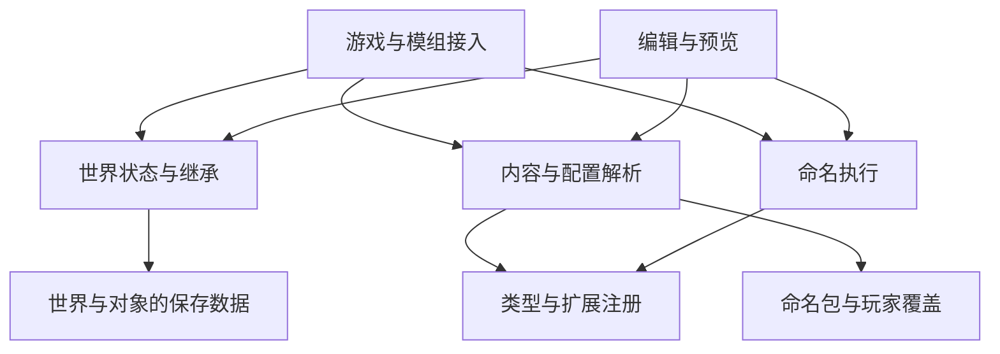

# 架构与执行流程草案

更新日期：2026-11-17。

本文把已确认的产品行为整理为模块职责、依赖和调用流程，目的是让规则、内容、游戏接入、编辑和保存能够分别维护。产品结论以[设计讨论](设计讨论.md)为准，入口范围见[原版命名覆盖清单](原版命名覆盖清单.md)，具体规则数据见[规则与数据模型草案](规则与数据模型草案.md)。

文化控制结构、语言控制词库、默认来源、姓氏继承、命名生命周期、包切换与编辑行为已经确认。下面的模块划分、缓存、初始化组织和接口形态是实现建议，尚未开始重构运行代码。

## 建议的六个模块

| 模块 | 负责什么 | 主要交付结果 |
| --- | --- | --- |
| 类型与扩展注册 | 注册命名类型、输入字段、词汇用途、条件与部件操作、校验和预览样例；检查稳定标识及声明依赖。 | 可供运行、内容校验与编辑器共同读取的定义。 |
| 内容与配置解析 | 加载命名包，组合基础方案、补充包与玩家字段覆盖，解析文化结构和语言词库，记录冲突与来源。 | 本次可使用的有效配置及诊断。 |
| 命名执行 | 根据只读请求筛选规则、选择词条、执行部件、校验、有限重试并返回结果。 | 名字、组成部分、规则与词条来源，以及失败原因。 |
| 世界状态与继承 | 管理世界设置、文化与语言的持久化调整、出生继承、初始化和对象复制所需的命名状态。 | 已确定的姓氏等长期状态，以及保存、恢复和分化后的配置记录。 |
| 游戏与模组接入 | 识别创建、首次命名或其他事件，确定文化与语言来源，提取类型输入，调用框架并写回结果，承担最终回退。 | 原版入口适配，以及供其他模组使用的统一调用入口。 |
| 编辑与预览 | 管理工作区、草稿、撤销重做、来源与冲突展示、预览输入和应用操作。 | 可编辑草稿、预览结果和经过检查的配置修改。 |

这些是职责边界，不要求拆成六个程序集，也不要求为每一类数据增加独立服务。第一版可以在同一项目内按目录组织，避免先建立大量空接口。

默认词库与规则作为内容维护，使用同一套命名包模型。物种差异主要写为内容和条件；物种特有的游戏信息由接入提供，复杂模组能力通过注册扩展提供。

## 依赖方向

建议让生成核心的输入与结果不依赖 Actor、Unity 窗口或游戏全局对象。原版适配层和调用模组把对象转换为声明过的输入；扩展回调同样遵守预览不写世界的约定。

有效配置由解析模块提供，执行器不在每次取词时重新读包文件、合并玩家修改或寻找文化。界面通过同一模型编辑，不自行拼出另一套只能用于预览的规则。

## 一次普通命名

1. 接入识别命名类型与触发场景，检查该流程是否确实需要生成新名字；已有名字与玩家名字按对应行为处理。
2. 按已确认的来源规则选择文化与语言，提取物种、性别、作者、战争双方等声明输入，并提供已有姓氏等确定部件。
3. 解析当前生效配置，得到适用规则、词库、稳定语言偏好、覆盖及来源信息。缺少文化或语言的部分采用适用的世界默认方案。
4. 执行器使用本次独立的随机状态，完成条件判断、选规则、取词、部件执行与校验；尝试过程不修改共享定义或游戏对象。
5. 失败时在统一预算内重试，再依次尝试类型默认方案和接入方回退。回退继续尊重已确定的姓氏等部件，并防止重新调用同一补丁形成循环。
6. 成功后由接入方写入名字与需要保留的组成部分。失败尝试不提交半成品；诊断可用于编辑器和排错。

建议请求至少表达命名类型、配置来源、触发场景、随机种子、声明输入及确定部件。结果至少表达成功或失败、文本、组成部分与诊断；具体 C# 类型、字段名和调用签名尚未确定。

文化与语言来源只决定本次使用的配置，不会把船只、书籍或联盟强行改成具有另一方的文化与语言。原版仍负责对象归属及游戏规则。

## 出生与姓氏

出生文化决定从哪位亲代继承完整姓氏，与以后首次读取姓名的时机分别处理：

1. 接入在孩子的出生文化和亲代关系可用时，建立继承输入。
2. 继承流程先复用已经确定的姓氏；需要继承的亲代使用姓氏但尚未初始化时，先确定并保存亲代姓氏。
3. 按优先父姓、优先母姓或随机选择一位亲代的文化规则确定孩子姓氏，执行已确认的单亲、无姓和无亲代处理，并保存结果。
4. 以后生成姓名时，将该姓氏作为确定部件传入。文化、语言或命名包变化不会重新执行继承选择。

“尚未初始化”“本身不使用姓氏”“已有确定姓氏”需要有明确状态，不能都用空字符串表达。具体存储表示仍待定。

已确认出生时确定并保存姓氏，首次需要姓名时才生成完整名字。亲代姓氏初始化也不应为了取姓而递归生成其完整姓名。预览使用模拟或复制的继承输入，不调用真实对象的初始化与保存流程。

原版内部和其他补丁可能提前读取名字，具体接入点必须按实际时序验证；不能只凭方法名称选择一个 Postfix 就认为出生流程已经覆盖。

## 克隆、转变与事件改名

接入按已确认的[命名生命周期](设计讨论.md#命名生命周期)决定是否调用生成器。克隆复制姓名、姓氏与组成部分；亡灵转换和进化保留个人姓名及既有姓氏，新亚种另行命名。保留或复制原名的路径不应再次随机取名。

军队换国和装备重铸只对自动名字执行相应改名，玩家手改名字保留。命名包或文化、语言切换不触发上述事件，也不扫描全世界重取名字。生成、结果提交和长期状态复制分别由对应流程承担。

## 编辑、预览与应用

界面编辑结构化草稿，预览向解析模块提供“当前配置加草稿”的临时视图，再调用相同执行器。预览需要显示所选配置来源，使用自己的随机状态，不写对象或世界设置。

应用时统一校验结构、参数与依赖，再保存玩家实际修改的字段。已确认的结构或参数错误会保留草稿和当前生效配置；缺失包或模组按既定标记与回退规则处理。应用后更新有效配置，之后的新名字使用新内容。

建议运行配置与草稿各自拥有版本标记。草稿修改只使对应预览失效，实际应用才使运行配置的相关缓存失效。默认内容、玩家覆盖和最终有效值分别保留，才能同时提供来源说明和局部重置。

从文化编辑、跳转共享语言，到分别应用、切包和读档的操作建议见[编辑器交互草案](编辑器交互草案.md)。其中建议普通应用只提交当前对象，预览默认组合当前对象草稿与其他对象的生效配置；这些具体交互仍待评审。

## 初始化、保存和缓存

建议使用显式初始化流程，先准备通用操作和类型定义，再载入内容与依赖，最后根据世界配置解析有效方案。其他模组的注册时机需要有明确阶段，避免借助代码属性名或反射遍历顺序决定资源标识与依赖。

新世界的默认命名配置必须在世界名和玩家名首次生成之前可用。读档时恢复该世界的包选择、绑定、玩家修改及对象命名状态；不批量重取已有名字。新文化与新语言按已确认的来源继承方式初始化，之后独立管理。

包文件与注册定义可以全局共享，世界配置、草稿和有效配置缓存需要按世界隔离。建议按注册、包内容、世界设置和相关文化／语言修改的版本缓存解析结果；包切换或应用修改只重算受影响的配置，不扫描全世界改名。

语言偏好的稳定信息随语言保存，不能依赖某个运行时缓存是否存在。对象只保存需要长期保留的名字与组成部分；详细执行追踪按排错和预览需要提供，不要求每个对象保存整棵执行树。

缓存命中与否不应改变相同输入及种子下的结果。包更新仍使用当前安装内容，未编辑部分按既定规则更新；缓存不构成存档对旧包内容的冻结。

## 用实际对象检验边界

| 场景 | 模块如何配合 |
| --- | --- |
| 孩子命名 | 出生接入和继承模块先确定姓氏；个人命名接入选择自身文化与语言，解析方案，执行器生成名字，接入保存结果。 |
| 联盟命名 | 联盟管理器适配取得发起国和另一方国家，使用发起国文化与语言，双方信息作为输入；不要求生成器遍历世界查找创建者。 |
| 亚种命名 | 接入提供物种、地点与生物群系，使用适用的世界默认内容；类型校验表达避重需要，不要求必有 Actor。 |
| Cultiway 法术 | 模组注册类型、输入与扩展，提供元素、形态、文化和语言；通用解析及执行生成名字，Cultiway 写回自己的法术对象。 |
| 玩家预览法术 | 编辑器按类型声明提供输入控件与样例，预览当前草稿；不需要先在世界中创建一门真实法术。 |

## 尚需定稿的内容

| 主题 | 待定内容 |
| --- | --- |
| 类型与公开接口 | 请求和结果的具体类型，输入与参数校验、扩展注册阶段、动态候选及缺失类型恢复。 |
| 规则与配置 | 部件和条件的最终结构、引用作用域、列表合并与冲突修复、多源词库权重。 |
| 生命周期接入 | 按已确认行为落实出生接入的准确时机、姓名状态的复制与保存、手改标记和失败回退；核对未列出的其他改名事件。 |
| 来源补全 | 国家、氏族、联盟格言等入口怎样确定所有者的配置来源，失效对象怎样回退。 |
| 编辑器 | 工作区间的跳转、规则与词库控件、预览输入、应用和冲突修复的完整交互。 |
| 实施与验收 | 根据模块和原版覆盖清单确定阶段，准备默认内容、隔离运行的核心验证及游戏内场景。 |

这些技术细节继续记录为草案，不改变已经确认的产品行为。实施顺序与各阶段完成条件见[分阶段重构计划](分阶段重构计划.md)，阶段 0 先收敛接口与格式，再进入核心和游戏适配实现。
