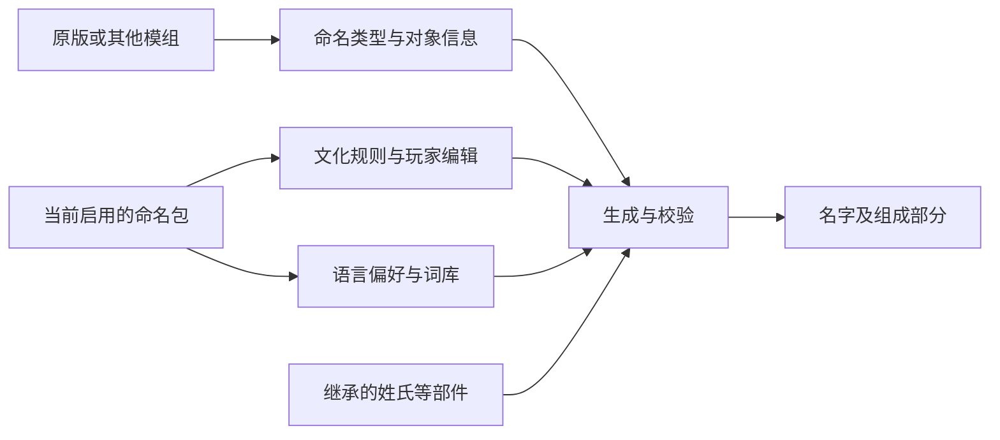

# 命名框架设计讨论

更新日期：2026-11-17。

文化命名学的入口、原版规则与中文规则的关系、文化和语言分化以[原版命名学整合方案](原版命名学整合方案.md)为下一版设计。本页保留此前讨论。

中文名需要覆盖原版全部自动命名入口，为生物等对象提供合适命名和适用的姓氏继承，让玩家编辑文化命名学，让语言影响词库，并向其他模组开放新的命名类型。命名内容应能够独立打包、组合和装卸，避免每种词库改版都重新分发整份模组。

当前处于设计讨论阶段。产品行为已经确认的部分记录如下；具体规则格式、扩展接口、编辑器布局、存档结构与实现阶段仍需继续讨论。简短入口见[讨论总览](../命名框架重构-摘要.md)。

## 目标与使用者

| 使用者 | 希望完成的事情 |
| --- | --- |
| 普通玩家 | 使用覆盖原版生物的默认命名，切换风格，按文化修改规则，调整语言用词，管理命名包。 |
| 命名包作者 | 修改和扩展词库、规则及预设，单独分发内容，并说明适用对象。 |
| 其他模组作者 | 注册功法、法术等新命名类型，提供对象信息，复用词库、文化编辑、语言偏好和命名包能力。 |
| 中文名维护者 | 能够定位命名路径、规则来源和失败原因，适配原版更新，维护存档与扩展兼容。 |

默认内容需要按生物和命名对象提供合适规则。姓氏、家族和继承机制按适用情况使用；普通动物、特殊生物、船只等可以使用各自的命名方案。

## 原版覆盖范围与质量

已确认覆盖原版实际存在的全部自动命名入口，按源码盘点后逐项列入验收清单：

| 范围 | 包含内容 |
| --- | --- |
| 生物个体 | 四大种族、其他文明生物、动物、怪物、特殊生物和船只等。 |
| 生物分类 | 亚种等具有独立命名流程的对象。 |
| 社会对象 | 城市、国家、文化、语言、宗教、家族、氏族和联盟。 |
| 其他自动命名 | 战争、装备、书籍、格言、世界名等。 |

默认内容需要符合对象特点，姓氏机制按适用情况使用。重名要求由各类型决定，人名允许重复，需要唯一名称的对象采用有限尝试和回退。

验收同时检查覆盖、有效性、长度、重复情况、继承正确性，并抽样判断名字是否合适。具体入口清单、默认内容、各类型约束、样本量和验收阈值在后续设计中细化。

首轮源码核对已整理为[原版命名覆盖清单](原版命名覆盖清单.md)，记录主体入口、军队与亚种的独立路径、衍生与复制流程、姓氏初始化时序，以及后续验收场景。清单尚未经过游戏内验证，不代表覆盖已经实现。

### 默认命名包风格

已确认默认内容整体用中文呈现，保留物种特色，追求自然易读。例如：

| 对象 | 默认方向示例 |
| --- | --- |
| 人类 | 中文姓氏与姓名，如“李青川”。 |
| 精灵 | 自然、星月意象的译名，如“艾琳·月叶”。 |
| 兽人 | 力量、氏族意象的译名，如“格鲁姆·裂牙”。 |
| 矮人 | 金属、岩石、工艺意象的译名，如“布伦·铁砧”。 |
| 普通动物 | 符合物种特点的昵称。 |
| 特殊生物、机器、船只等 | 各自适合的称号、代号或名称结构。 |

这些方向只决定初始默认方案，玩家仍可通过文化、语言和命名包自由调整。娱乐或梗名作为可选包提供。表中名字用于说明风格，不是必须使用的固定名称。

## 已确认的行为

### 命名主线与模板兼容

原版主体命名以命名学为主要接入路径。当前原版仍在使用的模板命名入口属于游戏适配范围，旧中文名模板格式的兼容暂缓。

原版的 `generateNameFromTemplate` 方法内部也会优先分派给命名学，因此方法名不能直接用于区分命名学与旧模板路径。

旧存档迁移、旧包格式导入和第三方改版的迁移适配暂缓，优先完成新框架。第三方改版作为需求参考，不作为本轮必须兼容的格式或代码版本。

### 文化与语言分工

文化决定名字结构和继承习惯。玩家能够修改特定文化的命名学规则。

语言决定结构中各部分使用的词库。默认通过稳定的偏好加权形成语言差异，在符合用途和条件的候选词中调整抽取倾向；玩家可以排除词条或限定子词库。两种语言即使来自同一个命名包，也应有稳定差异，读档不应使这些差异无故重新随机。

新文化有来源文化时，继承来源的方案选择、继承习惯和手工调整，之后独立管理。新语言有来源语言时，继承词库方案，形成相近但不同的稳定用词偏好。没有来源时，根据世界默认配置及物种、对象条件选择方案。

自然差异主要在文化分化或新语言产生时形成。已有文化和语言默认保持稳定，语言偏好不随时间自动漂移；玩家修改和命名包更新仍按既定规则生效。

### 命名时的文化与语言来源

已确认按命名对象选择本次使用的文化与语言：

| 对象 | 默认来源 |
| --- | --- |
| 生物个体 | 生物自身。 |
| 新建城市、国家、文化、语言、宗教、家族、氏族等 | 创建者已有的文化与语言。 |
| 书籍、装备 | 作者或制造者。 |
| 军队、船只 | 优先采用所属城市，缺少适用来源时采用所属国家。 |
| 联盟 | 发起国。 |
| 战争 | 按战争类型指定的命名方。 |
| 没有适用文化或语言的对象 | 使用世界默认方案，并按物种、命名类型和对象条件选择适用内容。 |

这些来源决定本次生成采用的配置，不改变对象在游戏中的实际文化、语言或归属。文化负责结构，语言负责词库；缺少其中一项时，对应部分使用适用的世界默认方案。新文化或新语言用创建者已有的信息为自己命名，其后续配置按已确认的初始化与分化方式建立。

姓氏继承仍以孩子出生时的文化为准；已有姓氏作为确定部件提供，不随这次名字生成时的来源重新选择。格言等未在表中单独列出的入口，需要随具体适配补齐所有者的来源选择。

### 命名规则骨架

每个文化的每种命名类型可以配置多条规则。每条规则包含使用条件、抽取权重和按顺序排列的组成部分，在符合条件的候选规则中按权重选择。

组成部分可以取词、引用已有信息、使用继承部件或输出固定文字。性别、身份、物种等差异主要通过规则条件控制，编辑器提供对应筛选，不为这些差异逐项增加独立命名类型。

规则使用结构化数据保存，每条规则和每个部件都有稳定标识。命名包、文化编辑、预览与实际生成共用同一套模型；条件、取词、继承引用等分别实现。字段名称、具体节点和序列化格式见待评审的[规则与数据模型草案](规则与数据模型草案.md)。

### 生成失败与默认方案

必需的词库、参数或部件缺失时，该规则失败；明确标为可选的部分允许省略。重试次数有上限，尝试其他有效规则或候选后仍失败时进入回退。

回退顺序为当前文化规则、该命名类型的默认方案、接入方处理。原版接入保留原版回退路径，回退仍尊重已有姓氏等继承信息。没有文化或语言的生物，从适用于该生物或命名类型的默认方案开始。

编辑器显示失败规则与原因，保留配置供修复。失败的命名尝试不写入半成品，也不把 `NO_NAME` 等错误占位符作为成功结果。

### 扩展命名类型

其他模组可以增加原版没有的命名类型，例如功法和法术。新增类型也需要支持按文化编辑和预览。

类型可以提供标识与显示信息、可用输入、词汇用途、自定义条件与组成部件、预览样例，以及校验与回退要求。框架根据声明提供文化编辑和预览入口，最终名字结构仍由文化规则决定。生成结果返回名字与组成部分，由对应模组写回自己的对象。

### 包切换与玩家修改

命名包装卸或切换后，已有名字保留，之后新生成的名字立即使用当前启用的包配置。玩家手动命名的对象同样保留原名。

安装与启用分开，玩家可以选择包的启用状态及其应用的文化、语言或命名类型。文化和语言分别选择基础方案，补充内容明确采用追加、替换或排除操作。多个包替换同一目标时，按玩家设置的优先级处理，界面显示冲突和最终来源。

玩家修改按实际编辑的字段保存覆盖，未修改部分跟随包更新，并提供重置操作。新增规则或词条独立保存，禁用默认规则的状态持续生效。相关包缺失时保留修改并明确标记，重新启用后恢复；原规则或部件被包更新移除时，保留修改并提示重新绑定或恢复。

已经自定义的输出顺序保持不变。包新增的输出部件标为“待加入”，由玩家选择是否采用；未修改顺序的规则自动跟随包更新，既有部件的未修改设置继续更新。

包文件全局共享，新世界继承全局默认预设。每个世界独立保存启用包、优先级、绑定与玩家修改，名字和姓氏随对应对象保存。存档保存配置与修改，包内容仍使用当前安装版本，未编辑部分继续跟随包更新。

### 姓氏继承与保留

以孩子出生时采用的文化决定继承方式。文化可以配置优先父姓、优先母姓或从任一亲代随机继承，完整继承一位亲代的姓氏，不拆分或拼接双方姓氏；孩子没有文化时，使用适用于该生物的默认继承方案。

默认区分亲代“尚未取姓”和“本身不使用姓氏”：前者先为亲代确定并保存姓氏，再执行继承。单亲继承该亲代；优先一方确实无姓时使用另一方已有姓氏。无亲代或亲代都不使用姓氏时，孩子的方案需要姓氏才按其语言和规则建立新姓氏。特殊繁殖方式允许模组补充亲代关系。

孩子继承的姓氏原样保留。之后的文化、语言变化和命名包切换不自动重取或转写姓氏，新语言影响新取的名。改姓作为独立操作。

### 命名生命周期

已确认以下默认行为：

| 场景 | 行为 |
| --- | --- |
| 出生 | 确定并保存姓氏，首次需要姓名时生成完整名字。 |
| 克隆 | 复制原姓名、姓氏及组成部分。 |
| 转变为僵尸、骷髅 | 保留原姓名与姓氏。 |
| 进化或升格 | 保留个人姓名；产生新亚种时单独为亚种命名。 |
| 军队更换所属国家 | 自动名字按新归属更新，玩家手改名字保留。 |
| 装备重铸 | 自动名字根据重铸结果重新生成，玩家手改名字保留。 |
| 切换文化、语言或命名包 | 保留已有名字和姓氏，影响之后的新命名。 |

游戏事件触发的自动改名与配置切换分别处理。克隆和亡灵转换需要保留命名状态，不能只复制显示文字后再次随机确定姓氏。首次命名时复用出生时已确定的姓氏，使用该次命名适用的文化结构与语言词库。

具体补丁时序、姓名与组成部分的复制和保存方式，仍在实现方案中确定。军队所属国家本身改名、其他物品变换等未在表中单独列出的事件，需要核对后补齐，不能默认为已确认的换国或重铸行为。

孩子出生取名与 Cultiway 法术命名的输入、返回和保存边界见[调用接口与数据格式草案](调用接口与数据格式草案.md)。其中的签名和 JSON 字段仍为候选方案，尚未实现为正式接口。

### 编辑界面与推进方式

重新设计一套更完善的编辑界面，统一从“命名管理”进入文化规则、语言词库、命名包和世界方案四个工作区。文化和语言编辑页面采用对象列表、编辑区和常驻预览布局。

预览允许调整性别、物种、元素、境界等输入，查看名字各部分来源与失败原因。预览使用模拟数据或实际对象信息的副本，不修改世界中的名字、姓氏或其他状态。

编辑采用“草稿、预览与检查、应用”的流程，草稿修改即时更新预览，应用后才影响之后的新名字。页面切换保留草稿，支持撤销、重做、局部重置、保存草稿和放弃修改。

先充分讨论行为和模型，再确定完整实现方案并进行全面重构。具体控件、应用范围和存储实现尚需确定。

## 框架职责模型

| 部分 | 职责 |
| --- | --- |
| 命名类型 | 声明对象类别、所需输入、展示信息、预览和校验要求。 |
| 对象信息 | 提供本次命名相关的生物、创建者、元素、形态、境界等信息。 |
| 文化规则 | 决定组成部分、顺序、可选分支、条件与继承习惯。 |
| 词汇用途 | 将命名规则中的用途连接到语言和具体词库。 |
| 语言词库 | 按用途确定候选词，并形成稳定的语言差异。 |
| 继承部件 | 提供已经确定的姓氏等信息，不因重新选词而改变。 |
| 生成与校验 | 组合候选，执行检查，在失败时按约定回退。 |
| 生成结果 | 返回名字及需要保存的组成部分，由接入方按约定写入对象。 |

这些职责用于指导后续设计，不预先固定类名、目录或公开接口。

## 命名规则与词汇用途

规则使用已经确认的“条件、权重、有序组成部分”骨架。例如：

| 命名类型 | 条件 | 权重 | 组成部分 |
| --- | --- | --- | --- |
| 人名 | 通用 | 4 | 姓氏、名字用字、名字用字。 |
| 人名 | 通用 | 1 | 姓氏、名字用字。 |
| 法术 | 火属性 | 1 | 火属性修饰、形态词、术法后缀。 |

这里的权重和内容仅作示例，不规定默认命名包的实际取值。

文化规则应能够通过词汇用途引用内容。例如文化中的姓名结构可以表示为：

`[姓氏] [名字用字] [名字用字]`

语言再决定“姓氏”和“名字用字”使用哪些词库，以及偏好哪些词。这样，同一文化的结构可以用于不同语言，调整语言用词时也能保留文化结构。

具体词库仍可直接引用，例如现有的“百家姓”“千字文”。默认规则优先通过用途连接词库，直接引用的适用场景和缺失处理需要继续约定。

上述方括号示例表示可编辑的组成部分。已确认统一使用结构化规则和稳定标识，具体 JSON 字段、条件表达、部件参数、可选部分与引用、重试上限和默认方案配置，以及当前原版字形的接入，继续结合[模型草案](规则与数据模型草案.md)与编辑器设计细化。

## 语言与继承的组合

默认通过稳定的偏好加权形成语言差异。例如，同一套名字用字中，一种语言更常选“清、云、月”，另一种语言更常选“炎、雷、曜”，同时仍能使用其他符合条件的候选词。

玩家可以明确排除词条，也可以限定一种语言使用的子词库。偏好的具体计算、差异程度、默认方案匹配、保存方式，以及命名包更新后的变化，仍需确定。实现时需要保持候选充足，并考虑避免每种语言复制整套词库。

新文化和新语言按以下方式初始化：

| 情况 | 默认处理 |
| --- | --- |
| 新文化有来源文化 | 继承来源的方案选择、继承习惯和手工调整，之后独立管理。 |
| 新语言有来源语言 | 继承词库方案，形成相近但不同的稳定用词偏好。 |
| 没有来源 | 根据世界默认配置及物种、对象条件选择方案。 |
| 已存在的文化和语言 | 默认保持稳定，玩家修改和命名包更新按既定规则生效。 |

自然差异主要发生在文化分化或新语言产生时，已有语言的偏好默认不随时间自动漂移。分化时可变化的内容和差异幅度仍需细化。

生成姓名时，已经继承的姓氏与重新选取的名字用词分别处理。例如父母姓“李”，孩子使用另一种语言时仍保留“李”，孩子的名使用其当前语言对应的词汇。

继承方式以孩子出生时采用的文化为准。以父亲姓“张”、母亲姓“李”为例：

| 孩子的文化习惯 | 继承结果 |
| --- | --- |
| 优先父姓 | 张。 |
| 优先母姓 | 李。 |
| 从任一亲代随机继承 | 随机选择张或李，完整继承所选亲代的姓氏。 |

姓氏作为完整值继承，例如“欧阳”原样保留，不拆分或拼接双方姓氏。孩子没有文化时，使用适用于该生物的默认方案。姓氏确定后，文化或语言变化不自动改变原姓。

常见边界采用以下默认处理：

| 情况 | 默认处理 |
| --- | --- |
| 只有一位亲代 | 继承该亲代的姓氏。 |
| 优先继承的一方确实无姓，另一方有姓 | 使用另一方已有姓氏。 |
| 亲代使用姓氏，但尚未生成姓氏 | 先为亲代确定并保存姓氏，再执行继承。 |
| 无亲代，或亲代本身都不使用姓氏 | 孩子的方案需要姓氏时，按其语言和规则建立新姓氏。 |

“尚未取姓”和“本身无姓”需要分别表示，避免父母名字尚未生成时，兄弟姐妹各自随机取姓。特殊繁殖方式允许模组补充亲代关系。

特殊繁殖的亲代关系表示，以及姓氏初始化的具体时机仍需细化。

## 其他模组的接入

### 命名类型注册

命名类型需要独立于原版固定的 `MetaType`。候选方向是使用带命名空间的稳定 ID，例如：

- `worldbox:unit`
- `worldbox:city`
- `cultiway:spell`
- `cultiway:cultivation_method`

这些 ID 是设计示例，最终名称和格式尚未确定。原版类型通过适配接入，其他模组增加类型时不应需要修改中文名核心代码。

注册内容可以包括以下信息：

| 内容 | 示例 |
| --- | --- |
| 类型标识与显示信息 | “Cultiway 法术”、图标与说明。 |
| 可用输入 | 元素、形态、境界和创建者。 |
| 词汇用途 | 元素修饰、法术核心和术法后缀。 |
| 自定义条件与组成部件 | 判断修行方向，根据属性选择修饰词。 |
| 预览样例 | 一项火属性、剑形态的法术。 |
| 校验与回退要求 | 长度限制、重名要求、缺少信息时的处理。 |

框架根据声明提供文化编辑和预览入口。规则与词库可以随模组提供，也可以由独立命名包提供。

### 对象信息与预览

不同命名类型拥有不同输入，不要求所有待命名对象都是 `Actor`。原版生物可以提供种族、文化、语言和父母信息；法术可以提供元素、形态和等级；功法可以提供修行方向、境界和创建者信息。

其他模组负责解释自己的对象和语义，中文名统一处理词库、文化规则、语言偏好、组合与编辑。模组可以新增条件与组成部件，最终名字结构仍由玩家可编辑的文化规则决定。复杂候选筛选或评分需要的具体接口，结合 Cultiway 的实际需求细化。

例如，Cultiway 可以提供“根据功法属性选取意象”的部件，玩家将其放进“意象＋修行方向＋功法后缀”的结构中。

新增类型还需要能够提供有意义的预览输入，避免编辑器只能展示缺少上下文的占位结果。

### 生成结果与写回

生成结果返回名字和组成部分，由对应模组负责写回自己的对象。生成与对象修改分开，框架不直接依赖 Cultiway 等模组的对象结构。

结果字段、写回时机、校验和回退的具体接口，以及输入字段和部件参数的类型仍需确定。

### 法术命名示例

| 部分 | 示例 |
| --- | --- |
| 命名类型 | `cultiway:spell` |
| 模组输入 | 元素为火，形态为剑，提供法术等级等附加信息。 |
| 文化规则 | `[元素修饰] [形态词] [术法后缀]` |
| 语言词汇 | 元素修饰为“炎”“赤”，形态词为“剑”“刃”，后缀为“诀”“术”。 |
| 生成结果 | “炎刃诀”等符合规则的名字。 |

这个示例用于明确各方职责，不要求 Cultiway 当前所有命名算法立即迁入中文名。

## 命名包方案

### 内容范围

命名包需要支持提供完整方案，也能只补充某一部分内容。当前方向包括词库与词条权重、命名规则与条件、语言词库方案、适用对象与默认绑定，以及可选择的风格预设。

普通命名包优先采用纯数据，新增执行逻辑由代码模组注册，再由包引用。包允许的数据表达能力，以及是否需要其他扩展形式，仍需确定。

### 多包组合

已确认采用以下组合方式：

- 安装与启用分开。装入一个包后，可以选择是否启用，以及应用到哪些文化、语言或命名类型。
- 文化和语言分别选择基础方案。文化选择结构与继承规则，语言选择词库方案，同一世界可以同时使用不同风格。
- 补充内容明确声明追加、替换或排除操作，可以只调整某类命名或某个词库用途。
- 多个包替换同一目标时，按玩家设置的优先级处理，界面显示冲突和最终来源。玩家自己的编辑继续保留。
- 包可以同时提供基础方案和补充内容，无需强制划分为两种包格式。

例如，一个语言可以使用“中式基础词库＋人名增补包”，同时为某个文化单独选择城市命名规则。安装多个包不会自动混合全部词库。

进一步确认以下行为，算例与技术展开见[规则与数据模型草案](规则与数据模型草案.md#词条身份与重复引用)：

- 同一词条被多个词库引用时只算一次，采用最高有效来源倍率。倍率调整词条权重，不表示词库总概率份额。
- 同字但含义不同的词条独立保留，界面按显示文字分组，允许展开来源。
- 玩家可以排除当前语言、当前用途下的全部同字词条，也可以精确排除指定词条；包不能越过玩家排除。
- 多包修改同一字段按玩家优先级处理，同级不同值明确报冲突。
- 缺少 Cultiway 等模组时，仅相关内容不可用，其他内容继续工作，玩家编辑保留。

具体字段、依赖版本范围和编辑器设置交互继续细化。普通命名包的追加、替换和排除应能撤回并重新解析，不直接改写共享原始内容。

### 内容分发

内容作者应能够单独分发命名包，玩家无需替换中文名模组的代码和词库目录。导入、编辑、导出和复用方案的流程需要纳入编辑界面设计。

已确认默认将玩家编辑导出为只包含修改与新增内容的补充包，保留目标引用并声明基础包依赖。独立完整方案作为另一种明确的制作方式，使用同一包模型。

第三方改版用于分析词库、风格切换和内容分发需求。旧版数据的导入转换和新增代码行为的迁移适配暂缓；本轮先建立新框架自己的命名包能力。

## 存档与装卸

### 全局与世界配置

已确认采用“全局装包、每个世界独立配置、新世界继承默认预设”的方式：

| 内容 | 保存范围 |
| --- | --- |
| 已安装的命名包文件 | 全局共享，包含作者提供的词库、规则和预设等内容。 |
| 创建新世界时使用的默认预设 | 全局设置。 |
| 当前世界启用的包、优先级和默认绑定 | 随世界保存。 |
| 文化规则、语言偏好、继承习惯和玩家修改 | 随世界保存。 |
| 已有名字、姓氏等组成部分 | 随对应对象保存。 |

不同世界可以使用各自的命名风格，玩家也可以主动将预设应用到已有世界。存档保存配置与修改，包内容仍使用当前安装版本，未编辑部分继续跟随包更新。

切换包时重新计算有效内容，保留作者原始数据与玩家编辑的独立性。现有全局列表直接追加的方式，需要调整为能够撤销和重建的加载方式。

### 玩家修改与包更新

已确认按实际修改的字段保存覆盖，采用以下行为：

| 玩家操作 | 包更新或缺失后的行为 |
| --- | --- |
| 只修改某条规则的权重 | 保留该权重，其他未修改部分继续更新。 |
| 修改规则的组成顺序 | 保留顺序，未修改的部件设置继续更新。 |
| 包新增输出部件，玩家已经自定义顺序 | 保留玩家顺序，新增部件标为待加入，由玩家选择是否采用。 |
| 包新增输出部件，玩家没有修改顺序 | 自动跟随包的默认顺序更新。 |
| 新增自己的规则或词条 | 独立保存，不被包更新覆盖。 |
| 禁用包里的某条规则 | 保留禁用状态。 |
| 暂时卸载相关包 | 保留修改记录，缺失内容明确标记，重新启用后恢复。 |

包更新后，原规则或部件已经不存在时，界面提示需要处理，保留玩家修改，允许重新绑定或恢复。玩家只改一个权重时，仍能获得作者对其他未修改部分的更新。

已确认新增输出部件不自动加入玩家自定义顺序。缺失部件、部件类型变更及复杂列表编辑的具体修复方式，继续结合模型草案细化。

### 缺失内容与恢复

包缺失时保留修改并明确标记，重新启用后恢复。具体标记与重新绑定交互需要在编辑器设计中展开。

缺失包或模组导致生成不可用时，按已确认的有限重试和逐级回退方式处理：当前文化规则无法生成时使用该命名类型的默认方案，仍失败则交给接入方。失败原因保留，配置与编辑记录供恢复或修复使用。

具体重试上限、默认方案与接入方回退接口、缺失类型的保存与恢复、世界数据的具体保存方式，以及新框架的数据版本标记尚未确定。旧存档迁移暂缓。

## 新编辑器方向

### 工作区

已确认提供统一的“命名管理”入口，分成四个工作区：

| 工作区 | 主要操作 |
| --- | --- |
| 文化规则 | 选择文化与命名类型，编辑条件、权重、组成顺序和继承习惯。 |
| 语言词库 | 选择语言，调整词库来源、用词偏好、排除项和子词库。 |
| 命名包 | 安装、查看、制作、导入和导出包，检查内容与依赖。 |
| 世界方案 | 管理当前世界的包启用、优先级和默认绑定，保存或应用预设。 |

原版与扩展命名类型使用一致的文化编辑入口。各页面需要能区分默认内容与玩家修改，并支持重置选定部分。

### 页面布局与预览

文化和语言编辑页面采用类似布局：

| 左侧 | 中间 | 右侧 |
| --- | --- | --- |
| 对象列表与筛选 | 规则或词库编辑 | 常驻预览、内容来源和失败原因。 |

预览区允许调整性别、物种、元素、境界等输入，并查看名字各部分的来源。预览使用模拟数据或实际对象信息的副本，不修改世界中的名字、姓氏或其他状态。

### 草稿与应用

已确认统一采用“草稿、预览与检查、应用”的流程：

| 操作或情况 | 行为 |
| --- | --- |
| 修改规则、词库或世界方案 | 先修改草稿，预览立即刷新。 |
| 点击应用 | 更新生效配置，影响之后的新名字。 |
| 草稿有结构或参数错误 | 显示具体原因，允许保存草稿，继续使用原配置。 |
| 缺失包或扩展部件 | 明确标记，按已确认的缺失处理和回退方式运行。 |
| 切换页面 | 保留尚未应用的草稿。 |

提供撤销、重做、局部重置和放弃修改。已有名字仍按此前约定保留。

导航、部件与条件编辑、预览输入、应用范围及草稿恢复的候选方案已整理为[编辑器交互草案](编辑器交互草案.md)，并用“修改文化人名规则”的完整流程检验职责。配套[本地交互原型](原型/命名管理交互原型.html)只使用演示数据，不连接游戏；这些具体交互仍待评审。当前原版字形的接入和首个完整版本的具体能力清单也需要在后续设计中确定。

## 维护性与实现组织

后续重构需要明确原版接入、命名执行、默认内容、姓氏规则、命名包加载、编辑界面和存档的职责。

已有代码中的整理方向包括显式初始化顺序、资产 ID 与属性名解耦、补丁只承担接入、字形处理函数按职责组织，以及将单次执行状态与持久化写入分开。生成失败、词库缺失和包冲突需要能够定位到对应规则与来源。

具体模块职责、依赖与流程建议已整理为[架构与执行流程草案](架构与执行流程草案.md)，用于下一步评审；其中的模块组织和接口尚未定稿。

具体类和目录应由已经确定的扩展模型与存储约定推导。前面提出的目录划分属于维护性建议，不作为已经定稿的完整架构。

## 候选验收场景

| 场景 | 期望结果 |
| --- | --- |
| 原版命名覆盖 | 原版实际存在的全部自动命名入口逐项覆盖，默认内容符合对象特点，长度和重名要求按类型确定，生成与继承正确，并通过样本检查。 |
| 出生与姓氏 | 按孩子出生时的文化决定继承方式，无文化时使用适用于该生物的默认方案；之后文化、语言变化不自动重取姓氏。 |
| 生命周期 | 出生确定姓氏、首次需要时生成姓名；克隆复制命名数据，亡灵转换与升格保留个人姓名；军队换国和装备重铸按约定更新自动名字并保留手改名字。 |
| 文化编辑 | 修改某文化的规则后，该文化之后的新名字及预览符合规则。 |
| 语言差异 | 同包下不同语言有稳定差异，调整词库后结构仍由文化决定。 |
| 切换与卸载包 | 已有名字和玩家编辑保留，新名字使用当前有效配置；缺失内容按约定回退。 |
| 存档恢复 | 读档后文化编辑、语言差异、绑定和继承信息保持一致。 |
| 扩展类型 | Cultiway 注册新类型后，可以在文化中编辑、预览，并由独立命名包提供内容。 |
| 作者分发 | 修改词库和规则后能导出独立命名包，无需重发整份中文名模组。 |

这些场景用于约束后续方案，具体覆盖清单、质量标准和测试方法在实现计划中细化。

## 待讨论问题

实施顺序和各阶段的完成条件见[分阶段重构计划](分阶段重构计划.md)。以下事项用于收敛技术方案，不重复打开已确认的产品行为。

| 主题 | 需要确定的内容 |
| --- | --- |
| 编辑体验 | 在已确认的工作区、预览布局和草稿应用流程上，细化部件与条件的可视化表达、词库编辑、预览输入控件、应用范围和具体交互。 |
| 规则能力 | 在已确认的规则骨架与失败处理上，细化条件表达、部件参数、可选部分与引用、重试上限、默认方案配置，以及当前原版字形和模板入口的接入。 |
| 包组合 | 将已确认的词条去重、来源倍率、同级冲突、依赖隔离与导出方式落实为绑定、操作字段、校验及修复交互。 |
| 语言生成 | 在已确认的偏好加权、初始化与分化方式下，细化默认方案匹配、偏好算法与差异幅度、保存方式，以及包更新后的变化。 |
| 姓氏继承 | 在已确认的继承来源与常见边界上，细化特殊繁殖的亲代关系，以及姓氏初始化的具体时机。 |
| 扩展接口 | 在已确认的注册信息和职责边界上，细化字段与参数类型、注册与依赖关系、复杂候选筛选或评分，以及校验、回退与结果写回的具体接口。 |
| 数据保存 | 在已确认的配置划分、字段覆盖与回退方式下，确定具体保存方式、复杂列表编辑的合并、缺失类型的保存与恢复，以及新框架的数据版本标记。 |
| 覆盖与质量 | 根据当前原版源码盘点具体入口，细化默认内容、各类型约束、样本检查方法和验收阈值，再确定实施阶段与验收顺序。 |

## 暂缓事项

本轮重构暂不处理以下内容：

- 原版或旧中文名存档的命名设置迁移。
- 旧 TXT 词库、旧 JSON 命名规则的导入转换。
- 第三方完整改版中新增代码行为的迁移适配。

这些事项保留为后续议题。当前原版游戏的运行时命名接入，以及新框架自己的存档、独立命名包和装卸行为继续按已确认方向设计。

## 代码与内容参考

### 原版代码

- [命名入口与命名学分派](../../../Cultiway/.GameSource/Assets/Scripts/Assembly-CSharp/NameGenerator.cs)：主体命名优先获取文化命名学，旧模板方法也包含命名学分派。
- [原版命名集类型](../../../Cultiway/.GameSource/Assets/Scripts/Assembly-CSharp/NameSetAsset.cs)及[文化数据](../../../Cultiway/.GameSource/Assets/Scripts/Assembly-CSharp/CultureData.cs)：原版分类和命名学存储使用固定的 `MetaType`。
- [文化命名学与存档](../../../Cultiway/.GameSource/Assets/Scripts/Assembly-CSharp/Culture.cs)：规则缓存、文化演化与保存加载。
- [原版编辑器](../../../Cultiway/.GameSource/Assets/Scripts/Assembly-CSharp/OnomasticsTab.cs)：现有编辑入口与分类组织。
- [命名学数据](../../../Cultiway/.GameSource/Assets/Scripts/Assembly-CSharp/OnomasticsData.cs)：规则执行与短符号序列化。
- [语言](../../../Cultiway/.GameSource/Assets/Scripts/Assembly-CSharp/Language.cs)及[语言数据](../../../Cultiway/.GameSource/Assets/Scripts/Assembly-CSharp/LanguageData.cs)：语言实体与现有存储基础。

### 当前中文名与 Cultiway

- [中文名字形扩展](../../Source/ExtendOnomasticsLibrary.cs)、[命名学执行补丁](../../Source/Patches/PatchOnomasticsData.cs)及[姓氏继承](../../Source/Patches/PatchForFamilyName.cs)。
- [命名包加载入口](../../Source/ModClass.cs)、[词库加载](../../Source/WordLibraryLibrary.cs)及[模板加载](../../Source/ChineseNameGeneratorLibrary.cs)。
- [Cultiway 法术命名输入](../../../Cultiway/Source/Core/AIGCLib/SkillNamingContext.cs)与[规则组合](../../../Cultiway/Source/Core/AIGCLib/SkillRuleNameComposer.cs)。
- [Cultiway 功法命名](../../../Cultiway/Source/Content/Libraries/CultibookRuleComposer.cs)与[宗门命名](../../../Cultiway/Source/Content/Sects/SectNamingService.cs)。

### 第三方改版样本

样本位于 `/data/Downloads/wb_chinese_name/`：

| 压缩包 | 与本次设计相关的情况 |
| --- | --- |
| `1f031cdc4f1c4e47a13c9ff5880152ca.zip` | 包含日式改版内容；与下一个样本共有的 25 份 C# 文件内容完全一致。 |
| `f724aa6128cb434fa36404415388fea7.zip` | 包含另一套中文名内容，可用于检验词库和规则独立分发的需求。 |
| `全文明种族版中文名v2.0（风格切换版）手机可用.zip` | 包含风格切换、按种族和命名类型选择方案，以及更多词库和命名对象。 |

这些样本用于分析内容与分发需求。旧格式导入和改版迁移适配已经暂缓，不作为本轮兼容承诺。
