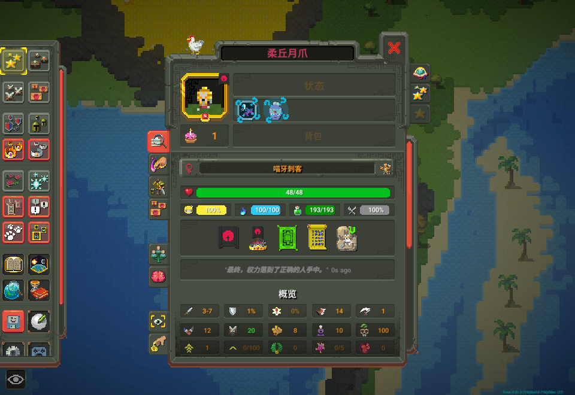

# 中文名

为 WorldBox 的生物、城市、国家等自动取中文名，新世界会按物种采用各自的风格。原版「命名学」里可以改排列、切换语言看预览，也可以搭配自己的命名包。

## 给接入模组的 Agent

在 NML 清单声明 `CHINESENAME` 依赖，从 `NamingApi.Current` 和 `NameRequest` 查找入口。可以为已有类别或新物种补规则、词库及候选来源，也可以接入法术、功法等新类别，并在原版「命名学」中注册分类、字形和预制条件。[API 实现](Source/Naming/NamingService.cs) · [请求与结果](Source/Naming/Contracts.cs) · [接入示例和包格式](Doc/命名框架重构/实现与验证.md#其他模组接入)
