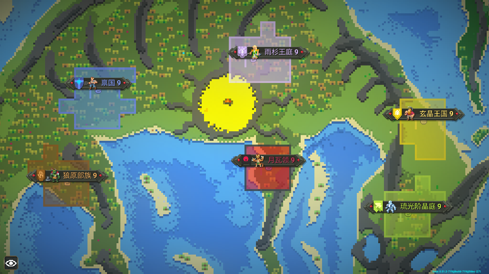
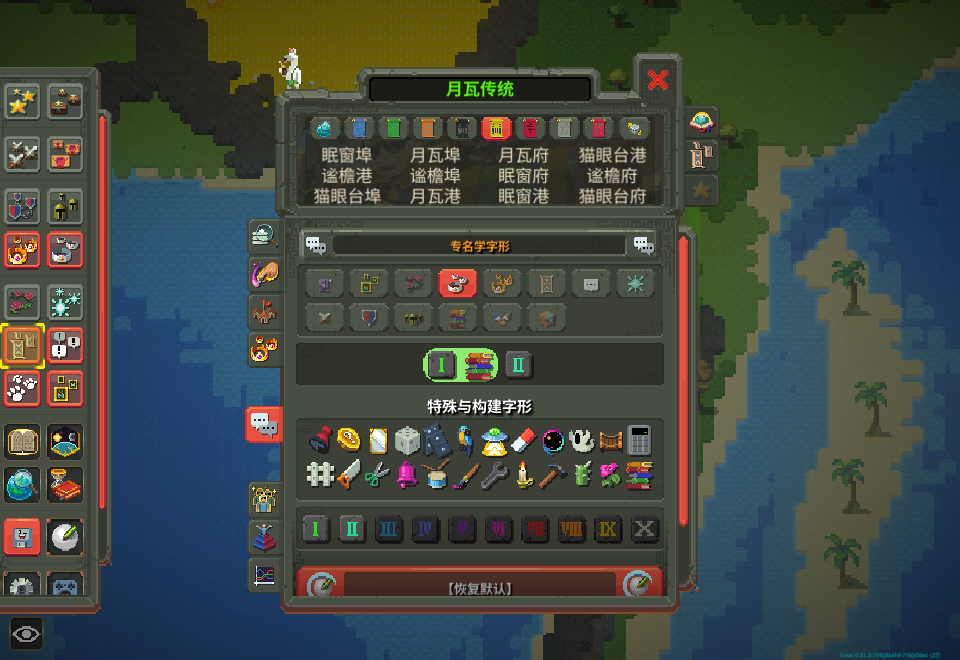

# 中文名

为 WorldBox 的生物、城市、国家等自动取中文名，新世界会按物种采用各自的风格。原版「命名学」里可以改排列、切换语言看预览，也可以搭配自己的命名包。

## 给接入模组的 Agent

在 NML 清单声明 `CHINESENAME` 依赖。用 `RegisterCategory` 登记新类别的输入、默认内容、字形和预制条件，用 `NameRequest` 接入实际取名。用 `ExtendCategory` 和 `WorldNamingInputs.RegisterInput` 给原版类别扩展输入、字形和条件。已有类别和新物种也可以补充规则或词库。[API 实现](Source/Naming/NamingService.cs) · [请求与结果](Source/Naming/Contracts.cs) · [接入示例和包格式](Doc/命名框架重构/实现与验证.md#其他模组接入)

文化外称、史书事件和新支系开姓可分别与中文名并列安装。外称和史书共装时，史书可引用作者文化的外称。新支系开姓通过 `WorldNamingInputs.RegisterSurnameFounding` 提供开姓时机。[文化外称](Addons/CultureExonyms) · [史书事件](Addons/HistoryEvents) · [新支系开姓](Addons/SurnameBranches)
